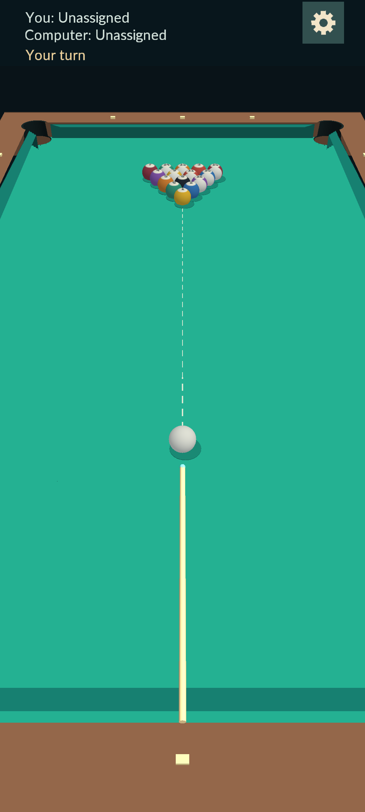
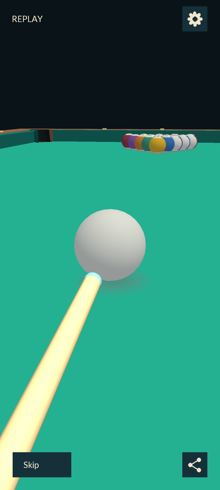
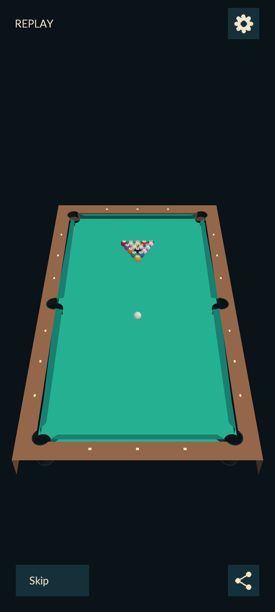
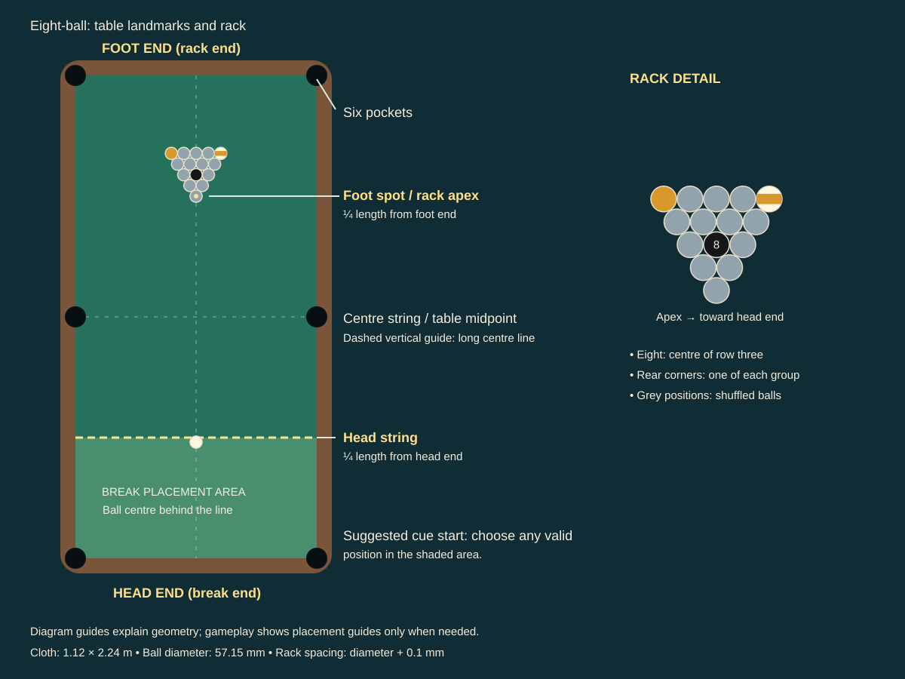
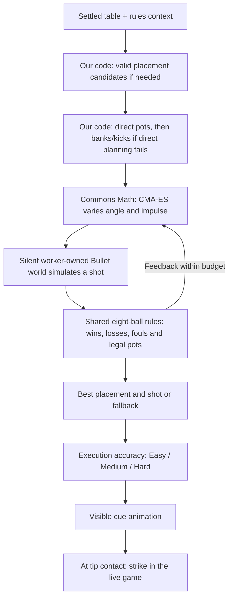
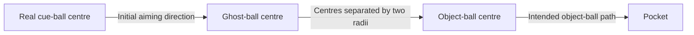

# Feltri 8-Ball — eight-ball against the computer

An offline 3D eight-ball game for Android. Play solids versus stripes against a local computer opponent, with simplified WPA rules, physical pockets, and continuous touch aiming and strokes.

## Table of contents

- [Screenshots](#screenshots)
- [Build and run](#build-and-run)
- [Rules of this game](#rules-of-this-game)
- [Controls](#controls)
- [Pocket replays and sharing](#pocket-replays-and-sharing)
- [Architecture and tuning](#architecture-and-tuning)
- [Automated verification](#automated-verification)
- [OnePlus 8T validation](#oneplus-8t-validation)
- [Assets and attribution](#assets-and-attribution)
- [Playing against the computer](#playing-against-the-computer)
- [How the computer opponent works](#how-the-computer-opponent-works)
  - [Starting shots: ghost-ball geometry](#starting-shots-ghost-ball-geometry)
  - [What CMA-ES searches](#what-cma-es-searches)
  - [Isolation, casual strength and lifecycle](#isolation-casual-strength-and-lifecycle)
  - [Current limits and tuning](#current-limits-and-tuning)

## Screenshots

<table>
<tr><th>Player view before the break</th><th>Replay: cue stroke</th><th>Replay: full table</th></tr>
<tr>
<td></td>
<td></td>
<td></td>
</tr>
</table>

See the [screenshot gallery](docs/images/), including the [diagonal replay view](docs/images/replay-diagonal.png), and [media refresh procedure](docs/gallery.md). The current [30-second gameplay video with synchronized game sounds](https://github.com/user-attachments/assets/7ac66daf-dac7-452c-bdff-470245067b74) is attached to [PR #18](https://github.com/ffeltrinelli/pool-android/pull/18); its [preview](docs/images/gameplay-preview.png) is committed. Regenerate it at `build/reports/gameplay-demo/gameplay.mp4` using the gallery procedure. [Audio credits](assets/audio/README.md).

## Build and run

Requirements: JDK 21, Android SDK platform 36, and build-tools 35.0.0. Android Studio can import the root Gradle project. The Gradle wrapper is included; dependencies need network access on the first build.

In Android Studio, select **JDK 21** as the Gradle JDK in Settings → Build Tools → Gradle; this matters if the IDE bundles JDK 25.

Set `JAVA_HOME` to your JDK 21 installation. Set `ANDROID_HOME` to your Android SDK, or create an ignored `local.properties` containing `sdk.dir=/absolute/path/to/sdk`.

```sh
./gradlew :android:assembleDebug
adb install -r android/build/outputs/apk/debug/android-debug.apk
adb shell am start -n io.github.ffeltrinelli.pool/.android.AndroidLauncher
```

The app is `io.github.ffeltrinelli.pool`, version 0.1.0. It supports API 26+, targets **API 34** to match the OnePlus 8T, and compiles against API 36 because libGDX's Android dependency requires it. Compile SDK does not set the device requirement. This is a sideloaded demo, not a store release.

For desktop development:

```sh
./gradlew :lwjgl3:run
```

The Gradle task adds macOS's required `-XstartOnFirstThread`. Mouse dragging uses the same gesture interpreter as touch. Collision, cue and pocket-drop sounds play on both platforms and follow the device media volume.

## Rules of this game

Clear your seven solids (1–7) or stripes (9–15), then legally pocket the eight in any pocket to win. The table stays open after the break; the first subsequent legal shot pocketing only one group assigns it to the shooter. Keep shooting when you legally pocket your own ball, otherwise the turn passes. Hit your group first (the eight only after clearing your group); if nothing is pocketed, a ball must reach a cushion after contact. Scratches, wrong/no first contact, off-table balls, and failure to reach a cushion are fouls. The incoming player gets cue ball in hand. Pocketing the eight early, while fouling, or knocking it off-table loses the rack. There are no ball-count scores or draws.

| Situation | This game's rule |
|---|---|
| Breaker | Human on application launch; Restart and Play again alternate breakers |
| Fresh break | Place the cue ball behind the head string; pocket a ball or send four distinct object balls to cushions |
| Insufficient break | Message, automatic fresh rack, opponent breaks |
| Eight on break | Return it to the foot spot, or nearest available position on the spotting line; never an immediate win/loss |
| Break foul | Opponent places behind the head string; cross that line before hitting a ball behind it |
| Ordinary foul | Opponent places anywhere valid; pocketed object balls stay down |
| Open-table mixed pot | Groups remain unassigned; the shooter continues if there was no foul |
| Opponent's ball pocketed | Stays down; not itself a foul, but does not earn another shot |
| Last group ball and eight together | Loss: the group must be clear before the eight-ball shot starts |
| Scratch while attempting eight | Ordinary foul if the eight stays on the table; loss if it is pocketed too |

The source is the [WPA Rules of Play, effective 15 September 2025](https://www.wpapool.com/wp-content/uploads/2026/01/2026.01.02-WPA-Rules.pdf), especially sections 1–4. **Our deviations:** no called shots or called pocket for the eight; legal accidental pots count; mixed-group open-table pots use the rule above; break choices resolve automatically; and there is no automatic referee/stalemate procedure. Use Settings → Restart for a stuck rack. On the rare open table with one group already completely gone, the eight is a legal winning target. Restricted placement also handles WPA's nearest-legal-ball spotting exception if every eligible target lies behind the head string.



The head string lies one-quarter of the table length from the head end; the foot spot lies one-quarter from the foot end. The rack's apex sits on the foot spot. Its eight is centred in row three and the rear corners contain opposite groups; other positions are shuffled. The suggested cue-ball position is not mandatory. Guide lines in this diagram explain the geometry; gameplay draws placement guides only when needed.

## Controls

- During placement, tap or drag the highlighted cue ball in Top view, then select **Confirm placement**. Invalid positions are red and cannot be confirmed. Confirming human placement switches to Player view.
- Human shots always use **Player view**. Touch inside the table viewport to begin; touching preserves the aiming direction. Drag sideways to turn the cue and camera together.
- Aided aim is enabled by default: a dashed line shows the direct cue-ball path to its first object-ball contact, or the first rail/jaw/pocket mouth if no ball is reached. It accounts for ball radius and does not predict rebounds or the object ball’s path. The guide extends the impact position by the cue-ball contact clearance along the original aim axis, without bending toward the contact normal. The dash pattern always reaches the endpoint.
- Drag down to withdraw the cue and up to advance it. You can make repeated practice strokes without lifting. A deliberate axial movement locks the aiming direction until release; lift your finger to re-aim.
- The forward-moving tip strikes on contact; pulling back first is optional. A faster push produces a stronger shot. Releasing before contact cancels the stroke.
- Wait for all balls to settle before aiming again. Additional fingers are ignored.
- Open the **gear** for Settings: toggle **Aided aim** and **Replays**, set **Difficulty** (Easy / Medium / Hard), then use **Restart** or **Exit game** side by side. Settings pauses play and stops current sounds. Use the top-right **X** or Android Back to resume. Exit closes the app immediately without saving the rack. **Play again** remains available after a result. Every fresh rack resets the cue toward the apex ball and aligns the player camera, with a 50 mm resting tip gap.
- At contact, the player camera smoothly pulls back while balls move; outer table edges may be off-screen. A retained human turn returns behind the settled cue ball; a handoff to the computer switches to Top view.
- Aided aim, replays, and computer difficulty are remembered across rack restarts and app launches; defaults are On, On, and Medium. Camera views are automatic: Player view for human shots, Top view for cue-ball placement and the entire computer turn. Older view-mode and play-mode preferences are ignored; all installations play against the computer.
- Ball collisions click, cushions thud, and cue contact plays a separate strike. Every physical pocket drop plays the pocket sound, including repeated cue-ball scratches after ball-in-hand placement. Stronger impacts are louder. There is no music or in-game volume control.

The HUD occupies a compact reserved strip above the game viewport, so group/turn text never covers the aiming scene. Gold notifications are distinct from the pale player labels. Placement guidance and invalid-position feedback share that top notification line; Confirm placement appears directly beneath it, above the table, only during human placement. Long notifications wrap within the strip while keeping the player labels visible. Table input is mapped relative to the viewport below it. Top view fits the outer table dimensions with an 80 mm total margin, keeping every rail and pocket visible below the HUD. Player view uses a raised first-person perspective and may crop parts of the table. The cue is drawn over the table borders and balls so it stays visible near rails in both views, including computer strokes. It keeps its perspective and lighting, and is still clipped at screen edges. Settings and the HUD remain above it; there are no cue obstruction, spin, or jump-shot controls.

## Pocket replays and sharing

Replays are enabled by default and remembered in Settings. After either player completes a legal scoring shot, a single replay shows up to three seconds of the final aiming/stroke sequence and the shot through its last object-ball pocket at **75% speed**, including the camera motion. Legal scoring breaks and winning eights qualify; fouls, early eights, and shots that only pocket the opponent's balls do not. Computer planning time is omitted.

The replay starts low behind the cue ball, showing the moving cue. Its camera follows the cue ball until the first ball or cushion contact, then pulls back over approximately 0.87 seconds to fit the entire table. Recorded ball rotations, pocket drops, and game sounds are replayed without simulating the shot again. The live match remains paused. **Skip** returns immediately; otherwise the final picture stays visible for **five seconds** before play resumes. During this hold, the button counts down **Skip (5)**, **Skip (4)**, through **Skip (1)**. Settings and backgrounding pause that timer too.

On Android, the square **Share** button remains available during playback and the five-second hold. Sharing pauses the replay while a clean portrait video is generated, then opens Android's system share sheet. Returning resumes the remaining replay/hold time. Export has a Cancel button; a failed export keeps the replay available for retry or Skip.

Shared videos are 720 × 1280 at 30 fps, H.264/AAC MP4, with the same 75%-speed camera/ball motion and synchronized game sounds at their original pitch. They begin with two silent seconds of the app splash, including its title and author. Controls, HUD, aiming guides, and the five-second decision hold are omitted; the final pocket sound finishes over the last picture. Videos use temporary app-cache files shared with read permission, and older exports are pruned after a day on subsequent launches. There is no microphone capture or storage permission. Desktop supports replay playback and settings; Android owns video encoding and system sharing.

The shared `replay` package owns recorded data and playback. Live rendering and playback share ball presentation data; Bullet and eight-ball rules run only for the live shot. The replay near plane increases from 0.01 m to 0.25 m during pullback to preserve depth precision. Export requests 24-bit depth on supported graphics contexts, with a 16-bit fallback for GLES 2 devices without `GL_OES_depth24`. Android encoding receives a bounded queue of offscreen RGBA frames, owns its codecs/EGL context on one worker, and mixes the recorded sound commands from bundled PCM clips. Export cancellation and restart invalidate the worker's result and release graphics resources on their owning threads.

## Architecture and tuning

The scaffold comes from official **gdx-liftoff 1.14.2.3**, using its Kotlin template and Bullet extension. Build tools: Gradle 8.11.1, Android Gradle Plugin 8.10.1, Kotlin 2.2.21, libGDX/Bullet 1.14.2. Ball materials are matte, with softer diffuse lighting to keep number patches legible. All graphics use libGDX models, materials, lighting, textures, and text rendering; there is no custom renderer or collision solver. `BallShadows` owns a generated feathered alpha texture and flat quads just above the cloth. A separate pass draws them after opaque geometry with depth testing and no depth writes, so they blend into the cloth without a raised rim. Live play, replays, and exported video share this rendering.

- `core`: `GameSession` owns rack/turn state and delegates pure decisions to `EightBallRules`; `ShotFacts` aggregates physics facts for both live and simulated shots; `CueBallPlacement` owns the human preview; `CueGesture` consumes timestamped table-space input and emits one `ShotCommand`; `PoolPhysics` owns Bullet bodies, fixed-step simulation and `PhysicsEvent` delivery; `PoolRenderer` draws the same scene on both platforms; `GameViews` selects `TopView` or `PlayerView` from turn ownership and placement; `GameHud` draws HUD/settings using shared `HudLayout` hit regions; `GameControls` owns modal suspension, while `SavedSettingsPreference` adapts persistence; `PoolAudio` owns preloaded impact effects. `AimPredictor` queries direct contact geometry without modifying physics; `AimGuideRenderer` draws depth-tested world-space dashes in one mesh. `GameInput` routes settings and gameplay pointers; `PoolGame` coordinates gameplay lifecycle and frames; `StartupGame` owns the splash and gates gameplay input/frames until initialization and three foreground seconds are complete. Startup runs only on fresh launch; background time is excluded. Immutable `TablePresentation` and `HudPresentation` carry per-frame display state instead of renderer flags. `ComputerTurn` has explicit idle, planning, selected, and stroking states; `ShotPlanningService` owns worker execution, `ShotSearch` owns request budgets/results, and `ShotSimulation` owns silent Bullet evaluation.
- `android`: immersive portrait launcher, safe cutout policy, disabled motion sensors, and keep-screen-on while foregrounded.
- `lwjgl3`: desktop launcher and separate test-only rendered fixtures. Fixtures do not introduce game debug controls.

Physics units are metres and kilograms. The table is 1.12 × 2.24 m; ball radius is 28.575 mm and mass is 170 g. Gravity and a static cloth support surface give Bullet real ball/cloth contact. Sliding friction turns a centre-struck ball from sliding into rolling; rolling and spinning friction bring it to rest without linear or angular damping. Bullet handles ball/cushion contacts and gravity-driven pocket entry. Pocket mouths measure 114.3 mm at corners and 127 mm at the sides, between cushion noses; jaw cuts are 142° and 104°, with 30 mm / 5 mm shelves. These dimensions follow the [WPA equipment specifications](https://www.wpapool.com/wp-content/uploads/2024/01/RECOMMENDED-EQUIPMENT-SPECIFICATIONS.pdf), without claiming a complete regulation table simulation. Shared pocket geometry builds the connected wooden rail caps, cloth-covered jaws, 3 mm rounded lips, physical openings and recessed liners. There is no scripted sinking, shrinking or fading: the production renderer uses Bullet's interpolated position and rotation until a ball is fully below the cloth. A ball is counted and removed after contact processing when its centre crosses 120 mm below the cloth inside a pocket. Out-of-bounds removal remains a logged safety fallback and never plays the pocket sound.

`TableGeometry` owns table/ball dimensions and the rack; `PocketGeometry` owns the shared pocket and cushion outlines. `TablePhysics` owns all static native table resources, separately from moving balls and session rules. `GestureTuning` centralizes dead zone, stroke threshold, lateral tolerance, velocity window, and power cap. Top-view placement input maps through its fitted camera projection. Player-view stroke input retains its original world-units-per-pixel scale in virtual gesture coordinates, independent of its moving camera and overhead framing; `CueGesture` interprets these samples. Forward velocity comes from up to the latest 75 ms of the current forward movement, with interpolation at the window boundary and history cleared on reversal or a stationary sample; distance controls cue contact, not power. Direction locks after at least two aligned samples in either direction and 14 mm of travel. Aligned movement previews immediately before locking. A 14 mm accumulated sideways threshold prevents small startup errors from rotating the cue; deliberate circling clears the preview and then tracks continuously. During established circling, the tip gap stays fixed until two consistent, mainly axial samples travel 14 mm; this suppresses radial finger wobble. At that point the cue takes up the accumulated stroke displacement and follows subsequent movement directly. The tip starts 50 mm behind the ball and follows axial displacement one-to-one, up to a 250 mm gap. Excess withdrawal is discarded so reversal responds immediately. Impulse is capped at 1.15 N·s.

The displayed cue is capped at 0.70 m through shared `CueGeometry`, an appearance choice rather than a full-size physical cue. Each view clips it to its camera.

`ViewTuning` centralizes player camera elevation (45°), vertical field of view (60°), horizontal distance behind the cue ball (0.95 m), near/far planes (0.01 / 20 m), and virtual aiming radius (0.30 m). Screen-right motion increases yaw; downward motion withdraws the cue. Direction locking and power retain the shared gesture tuning. Camera yaw stays fixed during strokes. At contact, a 0.65 s smooth pullback recenters on the table, retaining the shot yaw and 45° elevation. The overview uses 80% of the full-table-fit camera distance for larger balls; outer table edges may be cropped, as preferred during device review. The player overview holds while the human shot moves and during human-shot results. A retained human turn returns to the cue ball over 0.45 s. A computer turn switches immediately overhead; returning to human aiming starts behind the settled cue ball. Computer-shot results remain overhead. The near plane increases from 0.01 to 0.25 m during pullback to preserve depth precision. Settings/background suspension pauses the camera animation too; rack restart resets it. Settings and OS suspension are independent; returning from the background with settings open keeps the shot paused. Aided aim, replays, and difficulty are saved; racks are not saved.

Physics advances at 120 Hz with up to 100 ms / 12 steps of catch-up per render frame. Rendering interpolates the previous and current poses. Input unlocks after 300 ms of low linear and angular speed. A separate contact-stability check also accepts cloth-supported balls that stay within a 0.5 mm position envelope and 2° orientation envelope for that interval, despite tiny solver velocity spikes. It requires instantaneous speeds below 0.025 m/s and 0.8 rad/s and a centre within 1 mm of cloth height; genuine rolling, continuous spin and falling do not qualify. Backgrounding freezes simulation and cancels gestures; resume drops its first delta to prevent catch-up. Process death starts a new rack.

Object-ball numbers are baked into two opposite circular patches on each sphere's texture. Numbers and stripes follow the same interpolated Bullet orientation; markings can rotate out of view. A restart faces one number upward. There is no separate visual rolling calculation.

`PhysicsTuning` centralizes solver iterations (10, Bullet’s default), gravity (9.81 m/s²), cloth friction (0.8), ball friction (0.25), ball rolling friction (0.00035), ball spinning friction (0.001), linear sleep/settling speed (0.012 m/s), angular sleep/settling speed (0.3 rad/s), and the 0.3 s quiet interval. Bullet combines the contacting materials' coefficients; these are engine settings, not measured cloth specifications. Cloth restitution is zero; balls retain restitution 0.94 and cushions 0.78. Cloth contacts never trigger sounds or pocket capture. The rigid support has six real openings. A single convex central face avoids triangle seam artifacts on the main cloth; convex peripheral pieces and curved lip meshes extend support up to the openings. Recessed liner contacts use friction 0.35 and restitution 0.15; they are silent. The raised back liner slopes inward at its top to direct fast entries downward. No fabric deformation, cloth-direction effects, physical ball-return mechanisms, or spin controls are simulated.

Settling also recognizes bounded contact rocking: over the full 0.3 s quiet interval, a ball must remain within 1 mm of its anchor and two degrees of its anchor orientation, near cloth height, with capped linear/angular speed. This handles residual cushion jitter without a shot timeout or stopping continuous rolling/spin. Once the whole table settles, Bullet bodies are put to sleep as well as zeroed so contacts cannot restart the jitter; later strikes and collisions wake them normally.

Pocket drops use selected sound C, “Pool ball falling into pocket” by freesman (CC BY 3.0). A dedicated `PocketDrop` physics callback, separate from rule events and impact strength, queues it exactly once, including scratches. It uses fixed nominal gain 0.35 and the shared eight-voice / total-gain budget; pocket sounds take priority over ordinary impacts. Jaw rebounds retain cushion audio. Pause, settings and restart clear pending playback, and restart clears per-ball duplicate suppression. See [audio credits](assets/audio/README.md) for the source, licence and edits.

`UiFonts` owns display-sized TrueType atlases for splash and HUD text, using actual backbuffer/framebuffer width rather than logical window width. Rebuilding on width changes disposes old atlases; ordinary frames reuse them. Text styles preserve logical layout sizes.

Native bodies and graphics resources have explicit owners and disposal paths. A restart reuses shared collision shapes and models while replacing ball bodies. `AGENTS.md` contains the locally embedded clean-code instructions and screenshot requirements for PR descriptions. See the current [eight-ball implementation and documentation review](docs/eight-ball-review.md), or the historical [computer-only cleanup review](docs/computer-only-cleanup.md).

`AudioTuning` centralizes minimum impulse (0.002 N·s), full-volume impulse (1.15 N·s), maximum gain (0.45), eight concurrent voices, and summed gain budget (1.0). Bullet impact events are separate from session rules, aggregate contact-point impulses per pair per step, and suppress repeated contact until separation. The cue effect is emitted only when the shot impulse is applied. Stronger pending hits take priority, and stronger new hits can replace quieter active voices. Sounds are stopped on pause/restart and disposed on shutdown. Audio failures are logged without stopping play.

## Automated verification

```sh
# Fast gesture/session tests and real native Bullet integration tests
./gradlew :core:test

# Opt-in fixed-plan difficulty calibration: 8 layouts × 64 seeds × 3 levels
./gradlew :core:difficultyCalibration

# Production renderer at 1080 × 2400, writing PNGs and HTML
./gradlew :lwjgl3:visualTest

# Real OpenAL decoding/source allocation; requires graphics and audio output
./gradlew :lwjgl3:audioTest
# On headless Linux, use OpenAL Soft's null output:
# ALSOFT_DRIVERS=null xvfb-run -a ./gradlew :lwjgl3:audioTest

# Android static checks and APK
./gradlew :android:lintDebug :android:assembleDebug
```

JUnit tests also cover legacy-view preference compatibility and saved aided-aim/difficulty selection, discrete slider capture and cancellation, seeded execution profiles and exact Hard commands, radius-aware aim prediction and obstruction, fresh-rack cue/camera alignment, exit delivery, modal hit routing and suspension, independent background/settings pause states, camera elevation/alignment/freeze/resize, virtual input without camera feedback, stable player circling, practice strokes, and player-input power independent of overhead zoom. JUnit tests cover continuous aiming/stroking, cancellation, noisy and multi-pointer input, power scaling/capping, exactly one impulse, settling, game outcomes, restart, native collisions, six physical pockets, high-speed cushion hits, rack integrity, fixed-step consistency, stable cloth support, sliding-to-rolling slip, energy loss, angular settling, and pose reset. Physics assertions use tolerances rather than exact trajectories.

Rendered smoke tests capture 121 deterministic scenarios: table and rolling markings, six pocket approaches and physical drop stages, views and camera transitions, aided aim, cue visibility, computer strokes, settings/difficulty, group ownership, eight-ball turns, and valid/invalid cue placement. Detail crops accompany rolling and pocket fixtures. Captures use the graphics thread at 1080 × 2400 after setup or a fixed simulation pre-roll. Assertions check fixture state; screenshots support human review without automatic image baselines. Rule tests exercise break legality, groups, retained turns, fouls, wins/losses, placement, and alternating breakers; native tests verify shot contact facts, spotting and isolated group-aware planning.

For an optional five-second player-view recording, generate deterministic frames with `POOL_RECORD_PLAYER_VIEW=1 ./gradlew :lwjgl3:visualTest`, then encode them with ffmpeg:

```sh
ffmpeg -framerate 30 -i build/reports/visual/player-motion-frames/frame-%03d.png \
  -vf scale=540:1200 -c:v libx264 -pix_fmt yuv420p -movflags +faststart \
  build/reports/visual/player-view-motion.mp4
```

This opt-in capture is test tooling; normal visual checks and CI do not require ffmpeg.

Reports:

- `core/build/reports/tests/test/index.html`: JUnit and Bullet results.
- `build/reports/visual/index.html`: scenario results, screenshots, viewport/backend, and failure details. Failed rendering scenarios preserve their last frame when capture remains possible.
- `android/build/reports/lint-results-debug.html`: Android lint.
- `build/reports/audio/results.txt`: real desktop audio decoding, source allocation, and lifecycle smoke results.

Visual tests need a working OpenGL context and fail if one cannot be created. On Linux CI they run under Xvfb with Mesa software rendering. Audio unit tests use a fake player to verify volume, prioritization, concurrency, gain headroom and lifecycle cleanup. Native Bullet tests cover impact classification/strength, repeated collisions, cue delivery, and silent pocket interiors. Pocket tests also cover soft/angled entries into all six pockets, high-power containment, physical descent and rotation, jaw deflections, shelf support, simultaneous drops with scratch precedence, exactly-once capture, reset during a fall, support seams and frame-partition consistency. The separate audio smoke suite checks all bundled WAVs and production playback through OpenAL; CI uses the null output driver, which verifies decoding and source allocation rather than speaker output. Rendered tests remain audio-disabled.

`.github/workflows/verify.yml` runs on PR updates and manual dispatch, and uploads APK, screenshots, HTML, JUnit XML, lint and audio reports. Relevant screenshots should be attached or linked in PR descriptions with short captions; use before/after images when practical. Local paths cannot serve as GitHub images.

## OnePlus 8T validation

The connected acceptance device is **OnePlus KB2003 / OnePlus 8T, Android API 34, 1080 × 2400, ARM64**. See [device validation](docs/device-validation.md) for observed results and remaining hands-on checks.

The opt-in device script operates the foreground game on an unlocked 1080 × 2400 phone, including Home/resume, settings-based restarts and opening break swipes. Camera views follow placement and turn ownership automatically. It stops before sending more touch input if the game leaves the foreground and does not change system settings:

```sh
python3 tools/device_check.py --adb "$ANDROID_HOME/platform-tools/adb" --seconds 600
```

It writes screenshots and `soak.json` under `build/reports/device/`. Performance uses short SurfaceFlinger presentation-time windows sampled every ten seconds; it is not a continuous frame trace. Run with only the intended adb device connected. Gesture comfort, deliberate potting from different positions, and slow/medium/fast touch calibration still require hands-on testing.

## Assets and attribution

Table/cue models, sphere textures, and HUD are built from engine primitives and repository source. The cartoon eight-ball icon and splash illustration were generated with OpenAI image generation; the selected orange comic-burst artwork and generation details are stored in [branding assets](assets/branding/README.md). The CC0 collision/cue effects and CC BY 3.0 pocket recording, original sources, edits and license notices are documented in [audio credits](assets/audio/README.md). Splash and gameplay UI text use [Lato Regular](assets/fonts/README.md), bundled under the SIL Open Font License and rasterized by libGDX FreeType at display pixel sizes. Ball-number textures retain the libGDX default font. The clean-code rules in `AGENTS.md` are attributed to [ciembor/agent-rules-books](https://github.com/ciembor/agent-rules-books/blob/main/clean-code/clean-code.nano.md).

To record the deterministic corner-pocket entry in both camera views (half-speed, no audio):

```sh
POOL_RECORD_POCKETS=1 ./gradlew :lwjgl3:visualTest
ffmpeg -framerate 30 -i build/reports/visual/pocket-motion-frames/frame-%03d.png \
  -vf scale=540:1200 -c:v libx264 -pix_fmt yuv420p -crf 22 -movflags +faststart \
  build/reports/visual/pocket-entry-motion.mp4
```

The optional recording uses test-only fixtures; normal play exposes no fixture controls. FFmpeg is needed only for encoding the optional video, not tests or CI.


## Playing against the computer

The computer is the only opponent. Both players follow the rules above, including retained turns after legal pots and ball in hand after fouls. The HUD shows group ownership, remaining balls and whose turn it is. A foul announcement identifies its reason for three seconds of active game time; Settings and background suspension pause it. The computer chooses its own cue-ball placement. Restart and Play again clear the rack and ownership and alternate the breaker. Preferences persist; racks and breaker order do not survive application restart.

You can open Settings during any turn. The computer's input is not controlled by your gestures. Top view covers the entire computer turn, including planning and moving balls; your next shot returns to Player view at your previous aiming heading. The computer cue becomes visible after planning: 350 ms at the 50 mm gap, 250 ms backswing to 120 mm, then 200 ms forward to contact. Contact applies one shot impulse and the existing cue sound. Its animation speed does not determine shot power. The aided-aim line is hidden throughout computer turns.

## How the computer opponent works

The opponent is an offline, one-shot numerical search, not a language model or a trained policy. **Apache Commons Math 3.6.1 supplies CMA-ES (Covariance Matrix Adaptation Evolution Strategy)**, a search algorithm that tries batches of variations and uses the better results to guide the next batch. Here, it adjusts shot direction and power; Bullet simulates each candidate. Our pool-specific code supplies starting candidates, outcome scoring, turn coordination and difficulty-dependent execution accuracy. No data is sent to a server.



### Starting shots: ghost-ball geometry

For each legal target ball and pocket, compute the desired object-ball direction toward the pocket interior. Place an imaginary cue-ball centre two ball radii behind the object ball along that direction. Aiming at this **ghost ball** gives an initial cue direction. Reject paths blocked by balls, cushions or jaws, ghost positions outside the playing bounds, and cuts with insufficient forward momentum transfer. The shared aim predictor checks the initial paths; actual pocket success is decided by Bullet.



A fixed-position shot shortlists up to four centered geometric pot candidates. If their seeds fail, it also tests up to four direct entries along the table axes before refinement or rebounds; these include pots running along a cushion. Object paths are checked to their actual pocket-mouth intersection, including off-center entries. After testing the first pot seed, a fixed-position shot also tests centre-ball contacts on up to two directly visible legal targets at 0.70 and 1.00 N·s, before the remaining pot seeds. These contact alternatives give the search a chance to satisfy the cushion rule when a pot is unavailable; the shared rules still reject scratches and other fouls. Ball in hand prioritizes placements with clear cue-to-target and target-to-pocket lanes, covering different legal targets before alternative routes to the same ball. It tries several distances behind each target while retaining the established 25 cm alignment preference. Each placement retains its exact intended-pot seed. Unchecked aligned positions and safe grid fallbacks follow clear routes; the geometric predictor is conservative near pocket jaws. It considers up to eight positions and evaluates a seed from every shortlisted position before optimization, rather than discarding later placements. When clear direct placements exist, at most two contact alternatives precede their refinement; a large list of contacts must not exhaust the direct phase. All share one search budget. Breaks seed a strong 1.10 N·s shot at the apex. The initial impulse in N·s is `clamp(0.18 + 0.16 × sqrt(cueDistance + objectDistance / cutCosine²), 0.08, 1.15)`, with distances in metres. This is a rough seed, not a second physics model. If direct planning fails, shortlist up to eight single-cushion banks, kick pots and kick contacts. A bank reflects the object-ball path toward a pocket; a kick reflects the cue path before its first object-ball contact. Reflection planes come from the actual cushion noses, offset by ball radius; pocket gaps, jaws and blocked travel segments are rejected. Both rebound families receive starting candidates when available. Bullet validates their outcomes, including the cushion contacts that distinguish a bank or kick from an incidental direct pot. Fallbacks prefer visible legal contacts, then geometric kick routes; if none exist, use a bounded unobstructed miss rather than deliberately aiming through an illegal blocker. An unevaluated fallback cannot guarantee a legal shot.

### What CMA-ES searches

The optimizer changes **angle and impulse together**, sampling populations of six and adjusting their search distribution from the scores. Each shortlisted direction gets a local angle window of ±0.14 radians (about 8°); initial standard deviations are 0.035 radians and 0.12 N·s. Impulse remains within 0.04–1.15 N·s. The optimizer receives no pool rules directly: it sees only the score returned by the simulator. It reuses a proven search implementation instead of introducing our own evolutionary algorithm.

Evaluate direct-pot and legal-contact seeds first. Direct planning receives half the attempt budget or 2.5 seconds from request start, whichever comes first, unless a completed simulation legally pockets its intended direct target. Such a success suppresses deliberate rebound planning and releases the full remaining budget to direct search. Otherwise, evaluate rebound seeds and refine them with the remaining budget; when no direct-pot candidates exist, enter that phase immediately after contact seeds. A turn allows up to 256 candidate attempts and a five-second deadline shared by all difficulties, placements and phases, including setup. Shortlist optimizer starts to fit at least an initial evaluation and six-member population rather than leave a small remaining budget unused. Each simulation uses the production 120 Hz physics and must settle within 30 simulated seconds. Incomplete or interrupted simulations cannot win. Bounds and deadlines are checked between physics steps. The best fully evaluated shot is retained even when the optimizer exhausts its budget. Ordinary simulations preserve the settled cue ball’s height, orientation and body order; only actual placement reconstructs it. Planner diagnostics report candidate kind, predicted first contacts, intended target, pocketed target IDs, predicted foul, phase attempt counts, geometric rejections, cache hits, setup/geometry/restoration/simulation times and physics steps. Known illegal first-contact directions are rejected before simulation, and identical position/command trials share their cached result. Direct geometry is generated once per shortlisted position and legal targets are cached within requests. Silent worlds omit audio-impact aggregation, and contact collection skips irrelevant cloth/support manifolds while preserving rule events.

The shared rules evaluate each completed simulation. A winning eight scores 100,000; losing the rack or requiring a new break scores −100,000; other fouls score −10,000. Otherwise the score is `100 × ownTargetPots + 10 + intendedPotBonus + pocketProximity − 0.01 × impulse`. A pot candidate retains its target-ball identity throughout optimization; `intendedPotBonus` is 2 when that legal target is pocketed and 0 otherwise. Contact alternatives receive no intended-pot bonus; kick contacts still identify the required first ball. Proximity is bounded to 0–1 and considers remaining legal targets. This prioritizes wins, avoiding losses/fouls, and legal pot count, then prefers the intended pot over an incidental pot before proximity and lower impulse. On an open table, targets include both solids and stripes; group assignment does not restrict the search until the rules assign a group. These are search weights, not gameplay points. Refinement retains a successful starting pot when a variation only improves proximity or power with an intended pot, the same legal pot count and rack outcome; those secondary improvements do not establish better execution tolerance. Additional pots, wins, foul avoidance and intended-pot preference still take priority. An incomplete simulation is rejected with a score below a losing completed shot.

### Isolation, casual strength and lifecycle

A single worker exclusively owns a separate Bullet world and disposes it on that same worker. A settled snapshot carries ball identity, position, height, rotation, group ownership, break status and placement entitlement; velocities are zero because meaningful movement has already ended. Native contact caches are not copied, so predictions are physically approximate rather than bit-identical to the live world. No planning simulation delivers live game or audio events.

The Settings slider has exactly three discrete levels. Tapping a stop selects it; dragging snaps to the nearest stop. The saved selection defaults to **Medium**.

| Difficulty | Gaussian angular standard deviation | Angular clipping | Uniform power variation |
|---|---|---|---|
| Easy | 1.2° | ±3.6° | ±14% |
| Medium (default) | 0.25° | ±0.75° | ±3% |
| Hard | None | None | None |

The historical Easy calibration targeted approximately 30% settled pot success on fixed layouts. Its execution-error values are unchanged; that historical measurement is not a new eight-ball win-rate measurement.

The planner returns an unmodified command. When a cue stroke starts, `ExecutionAccuracy` applies the selected seeded profile once, retaining impulse bounds. Medium preserves the previously accepted casual error calculation. Hard uses the exact planned command with no artificial direction or power error; **perfect execution does not guarantee pocketing**, because numerical search and physical predictions remain approximate. Every level uses the same CMA-ES algorithm, five-second deadline, 256-attempt cap and other search tuning. More time can improve the selected shot at every level even though Medium's execution accuracy is unchanged. Thinking remains visible for at least one active second. The live shot is animated using the final varied direction, so the cue matches the actual impulse. If planning fails, log the issue and use the best completed result or the geometric fallback.

Settings, backgrounding and restart invalidate pending work. A result can only reach the current match and turn. Difficulty changes save immediately without restarting the rack or dismissing Settings and affect the next unstruck computer shot, including a retained plan. Pausing an unfinished cue stroke resets its animation without firing; the raw selected plan and seed are retained on resume, so a changed difficulty is applied without compounding error. The cue always follows the final execution direction. Restart discards both the selected shot and animation. Planning metrics appear in Android logcat under `PoolAI`.

### Current limits and tuning

The three difficulty levels change execution accuracy only; there is no multi-turn lookahead or learning across matches. Candidate generation deliberately constructs single-cushion banks and kicks only when direct-pot planning fails. Multi-cushion routes and exhaustive rebound coverage are outside the bounded search; geometric mirrors are starting estimates, not a replacement for Bullet. A direct route that exists geometrically but never completes a legal intended pot does not prevent rebound planning. Time limits mean it selects the best completed attempt, not the globally best shot. Casual error and differences between restored and live contacts can turn predicted pots into misses.

Search limits are centralized in `OpponentTuning` and accuracy profiles in `OpponentDifficulty`; candidate-generation and animation constants live beside their respective algorithms. Device results, difficulty calibration and outstanding human checks are recorded in [device validation](docs/device-validation.md). Deterministic tests use fixed seeds and evaluation budgets rather than asserting exact planning times. See [AI review and benchmark procedure](docs/ai-planning.md) for desktop and OnePlus before/after evidence and opt-in measurements.

Apache Commons Math is distributed under Apache License 2.0. See [third-party notices](assets/licenses/commons-math3-NOTICE.txt) and the [licence](assets/licenses/Apache-2.0.txt).
